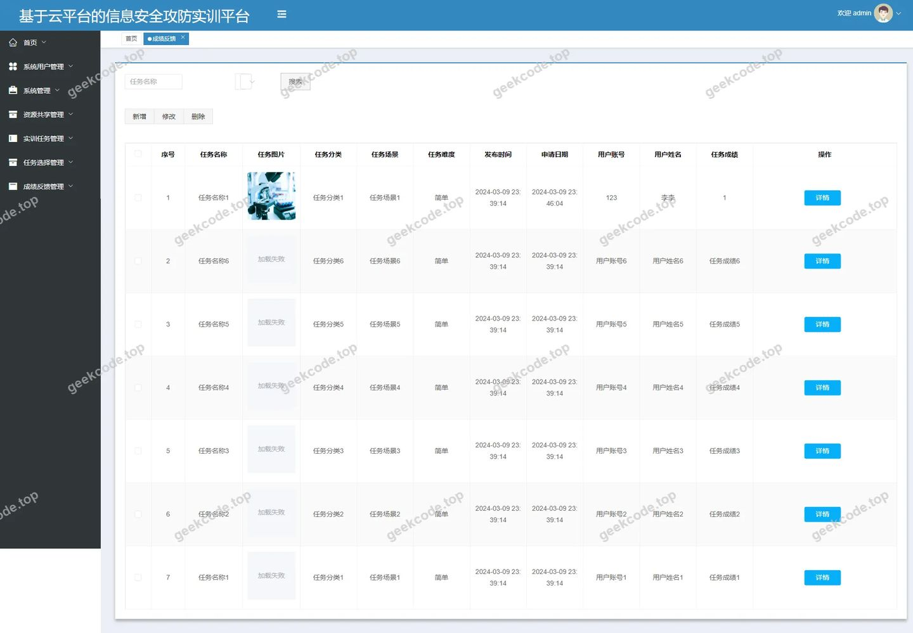
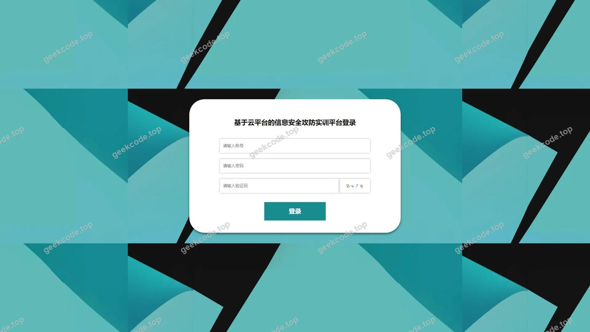
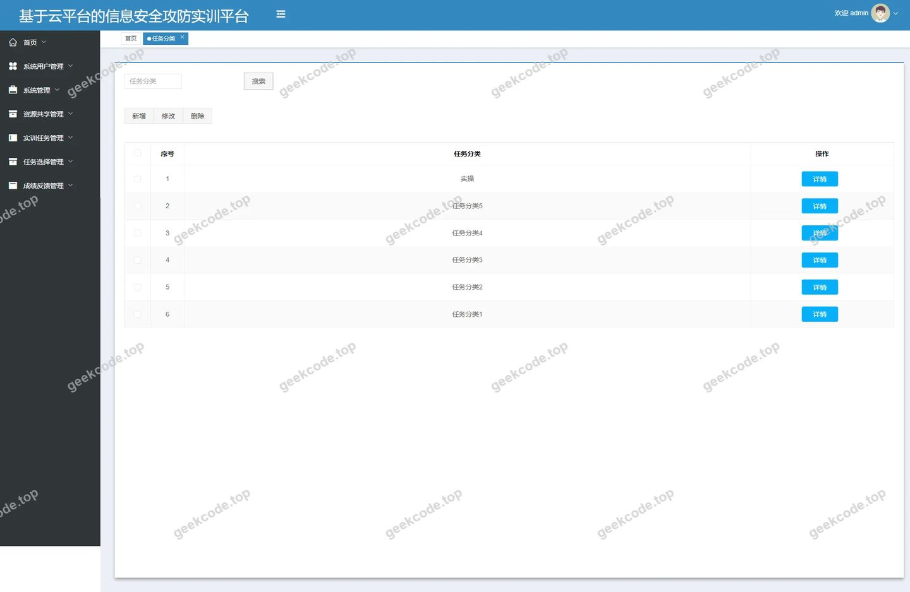
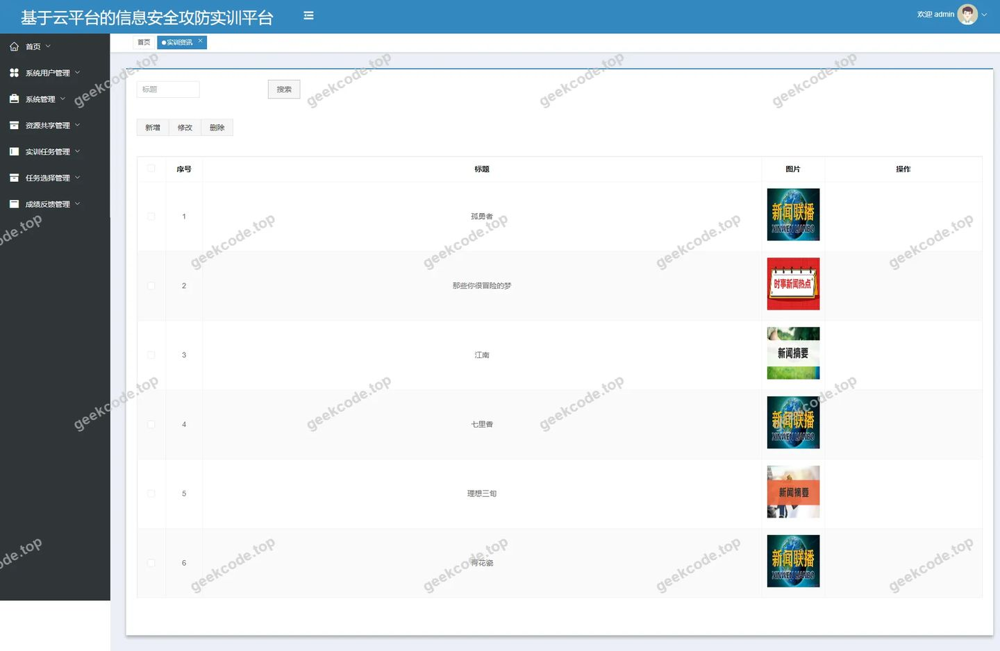
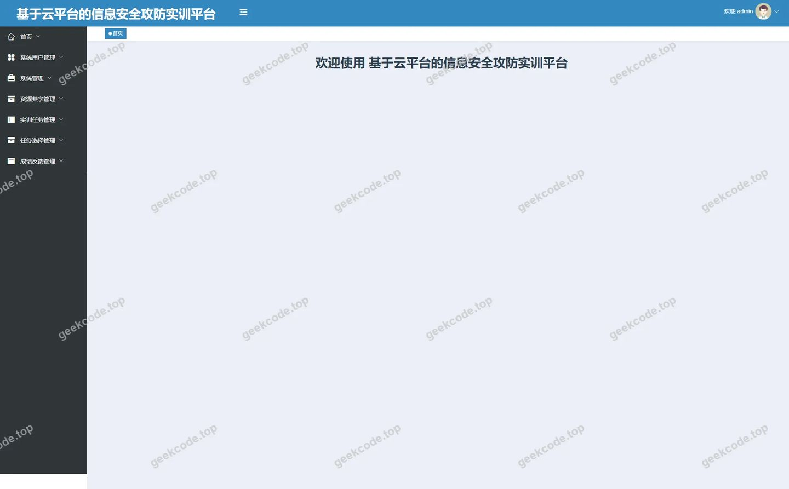
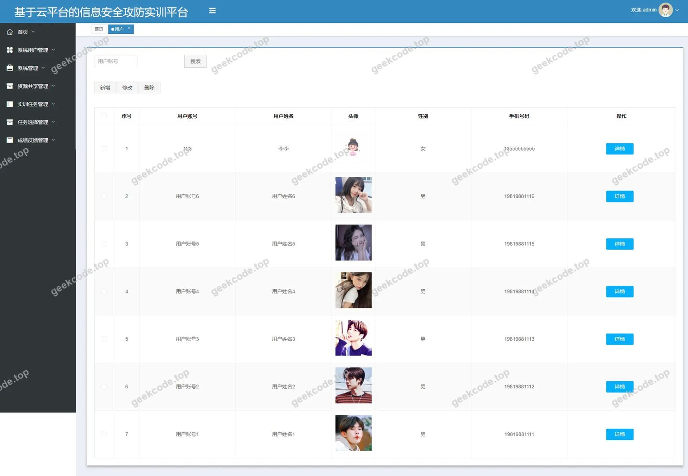
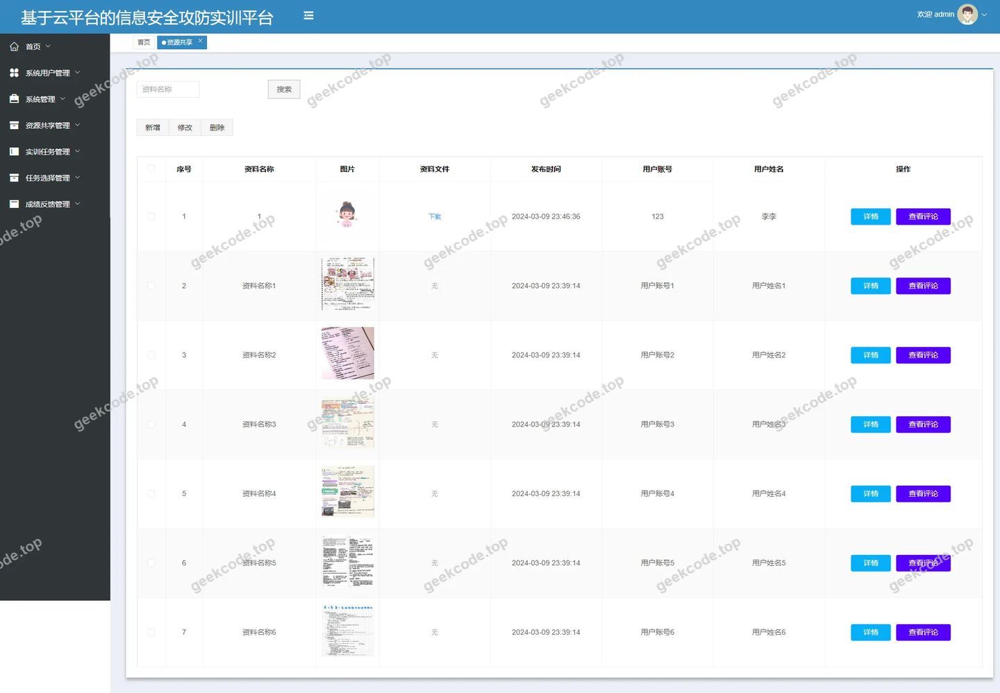
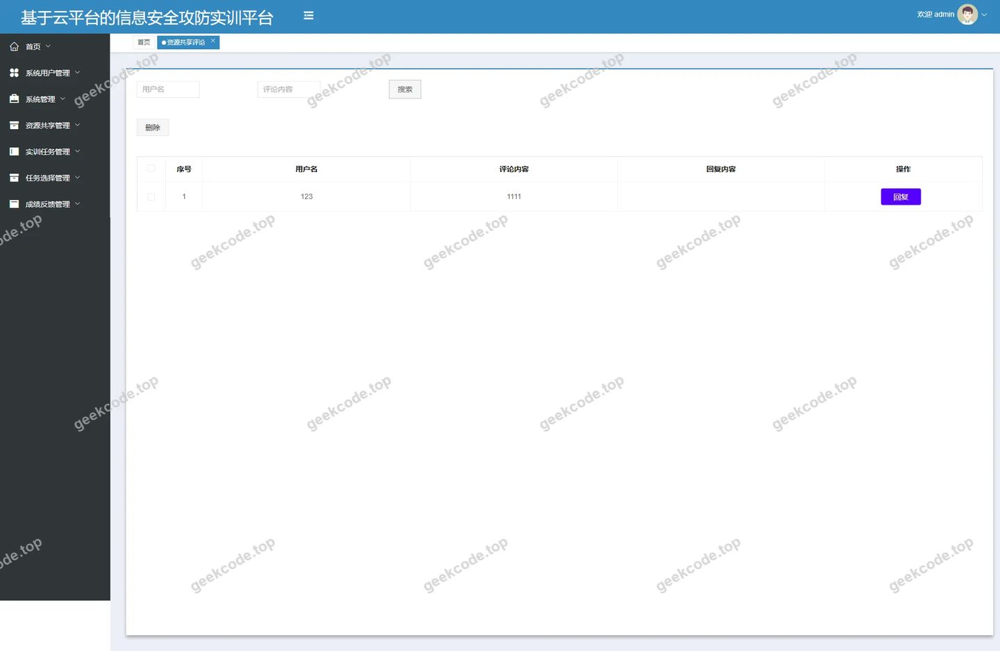

# java基于云平台的信息安全攻防实训平台

> 🎓 **计算机毕业设计 · java基于云平台的信息安全攻防实训平台**
>
> 本仓库只放**项目介绍 + 运行截图**（截图是站点带水印的原图，存在仓库 `images/` 里）。
>
> 👉 **完整可运行源码 / 数据库脚本 / 部署文档：[点我获取](https://geekcode.top/archives/java%E5%9F%BA%E4%BA%8E%E4%BA%91%E5%B9%B3%E5%8F%B0%E7%9A%84%E4%BF%A1%E6%81%AF%E5%AE%89%E5%85%A8%E6%94%BB%E9%98%B2%E5%AE%9E%E8%AE%AD%E5%B9%B3%E5%8F%B0?utm_source=github)**
>
> 💬 咨询微信：**ir9372**　|　🌐 更多项目：[极客代码 geekcode.top](https://geekcode.top/?utm_source=github)
>
> 📌 项目详情页：<https://geekcode.top/archives/java%E5%9F%BA%E4%BA%8E%E4%BA%91%E5%B9%B3%E5%8F%B0%E7%9A%84%E4%BF%A1%E6%81%AF%E5%AE%89%E5%85%A8%E6%94%BB%E9%98%B2%E5%AE%9E%E8%AE%AD%E5%B9%B3%E5%8F%B0?utm_source=github>

<table><td width="230" align="center"> <b>扫码加微信 ir9372</b></td><td valign="middle">📦 源码 = 项目介绍 + 全部运行截图 + 数据库 + 部署文档 👉 点上方任意截图，直接跳到 <b>极客代码 geekcode.top</b> 详情页</td></table>

---

<h1>java基于云平台的信息安全攻防实训平台</h1>
<h2>项目概述</h2>

本项目名为“java基于云平台的信息安全攻防实训平台”，旨在构建一个集教学、实训与资源管理于一体的信息化平台。项目核心目标是解决信息安全领域实训资源分散、任务管理复杂及反馈机制缺失的问题，为学习者提供系统化的攻防演练环境。适用人群包括参与信息安全学习的学生、教师以及平台管理员。技术架构上，后端采用 Spring Boot 框架结合 MyBatis-Plus 实现高效数据持久化，使用 Apache Shiro 进行权限控制；前端采用 Vue.js 框架构建响应式界面，通过前后端分离模式提升用户体验与系统可维护性。平台涵盖用户管理、实训任务分类、资源共享、成绩反馈等核心模块，支持多角色协同工作，确保实训过程的可追溯性与互动性。

<h2>技术架构</h2>
<h3>前后端架构</h3>

本项目采用经典的前后端分离架构设计。

<ul>
<li><strong>后端服务层</strong>：基于 Java 语言开发，核心框架为 Spring Boot。利用 <code>spring-boot-starter-web</code> 构建 RESTful API 接口，处理业务逻辑请求。数据访问层集成 <code>mybatis-spring-boot-starter</code> 和 <code>mybatis-plus</code>，简化 CRUD 操作并提高数据库交互效率。安全认证与授权模块引入 <code>shiro-spring</code>，实现细粒度的权限控制与会话管理。</li>
<li><strong>前端展示层</strong>：基于 Vue.js 生态构建（vue-integrated），负责页面渲染、路由管理及与后端接口的异步通信。前端分为“前台用户端”和“后台管理端”，分别对应不同的路由体系（如 <code>/index/...</code> 和 <code>/news</code>, <code>/yonghu</code> 等）。</li>
</ul>
<h3>核心技术选型理由</h3>
<ol>
<li><strong>Spring Boot</strong>：提供自动配置和起步依赖，快速搭建微服务或单体应用基础，降低配置复杂度。</li>
<li><strong>MyBatis-Plus</strong>：在 MyBatis 基础上增强功能，提供通用 Mapper 和条件构造器，显著减少样板代码，提升开发效率。</li>
<li><strong>Apache Shiro</strong>：相比其他安全框架，Shiro 更轻量且易于理解，适合中小型项目的权限管理需求，能够灵活控制菜单和按钮级权限。</li>
<li><strong>MySQL</strong>：作为主流关系型数据库，稳定可靠，配合 JDBC 驱动 (<code>mysql-connector-java</code>) 实现数据存储。</li>
</ol>
<h3>数据库设计要点</h3>

根据后台路由与实体映射，数据库主要包含以下核心表结构：

<ul>
<li><strong>用户信息表 (users/yonghu)</strong>：存储注册用户的账号、密码、基本信息及角色标识。</li>
<li><strong>实训任务表 (shixunrenwu)</strong>：记录具体的攻防训练任务详情。</li>
<li><strong>任务分类表 (renwufenlei)</strong>：对实训任务进行层级化管理。</li>
<li><strong>任务选择表 (renwuxuanze)</strong>：关联用户与具体任务的执行状态。</li>
<li><strong>资源共享表 (ziyuangongxiang)</strong>：存储上传的学习资料、工具包等资源。</li>
<li><strong>评论表 (discussziyuangongxiang)</strong>：记录用户对共享资源的讨论与反馈。</li>
<li><strong>成绩反馈表 (chengjifankui)</strong>：存储实训结果的评价与得分信息。</li>
<li><strong>资讯新闻表 (news)</strong>：发布平台公告或行业动态。</li>
<li><strong>收藏表 (storeup)</strong>：记录用户对资源的收藏行为。</li>
<li><strong>配置表 (config)</strong>：存储系统全局参数配置。</li>
</ul>
<h2>功能模块</h2>
<h3>前台用户端</h3>

前台主要面向普通注册用户，提供自助式学习与资源管理服务。

<ol>
<li><strong>用户中心</strong></li>
</ol>
<ul>
<li><strong>注册与登录</strong>：新用户可通过 <code>/yonghuRegister</code> 路径完成注册，登录后进入个人中心 <code>/index/yonghuCenter</code>。</li>
<li><strong>个人信息管理</strong>：查看及修改个人基本资料 (<code>/index/yonghuDetail</code>)。</li>
</ul>
<ol start="2">
<li><strong>实训任务管理</strong></li>
</ol>
<ul>
<li><strong>任务浏览</strong>：查看所有可用实训任务列表 (<code>/index/shixunrenwuList</code>) 及详情 (<code>/index/shixunrenwuDetail</code>)。</li>
<li><strong>任务选择</strong>：用户可根据自身进度选择特定任务进行实训 (<code>/index/renwuxuanzeList</code>, <code>/index/renwuxuanzeDetail</code>)。</li>
<li><strong>分类筛选</strong>：通过任务分类视图 (<code>/index/renwufenleiList</code>) 快速定位感兴趣的领域。</li>
</ul>
<ol start="3">
<li><strong>资源共享与社区</strong></li>
</ol>
<ul>
<li><strong>资源获取</strong>：浏览平台提供的学习资料和工具 (<code>/index/ziyuangongxiangList</code>)，查看资源详情 (<code>/index/ziyuangongxiangDetail</code>)。</li>
<li><strong>资源上传</strong>：具备权限的用户可添加新资源 (<code>/index/ziyuangongxiangAdd</code>)。</li>
<li><strong>互动交流</strong>：参与资源下方的评论区讨论，分享心得。</li>
<li><strong>收藏夹</strong>：将感兴趣的资源加入收藏夹 (<code>/index/storeupList</code>)，方便后续查阅。</li>
</ul>
<ol start="4">
<li><strong>成绩与资讯</strong></li>
</ol>
<ul>
<li><strong>成绩反馈</strong>：查看自己的实训成绩评价 (<code>/index/chengjifankuiList</code>) 及详细反馈 (<code>/index/chengjifankuiDetail</code>)。</li>
<li><strong>新闻资讯</strong>：浏览平台发布的最新安全资讯 (<code>/index/newsList</code>)。</li>
</ul>
<h3>后台管理端</h3>

后台面向管理员，提供全量数据的监控与维护功能。

<ol>
<li><strong>系统管理</strong></li>
</ol>
<ul>
<li><strong>登录页</strong>：管理员专属入口。</li>
<li><strong>首页仪表盘</strong>：展示关键数据统计概览。</li>
<li><strong>系统配置</strong>：管理网站基础参数 (<code>/config</code>)。</li>
</ul>
<ol start="2">
<li><strong>用户管理</strong></li>
</ol>
<ul>
<li><strong>用户列表</strong>：查询、编辑、删除注册用户信息 (<code>/yonghu</code>)。</li>
</ul>
<ol start="3">
<li><strong>内容管理</strong></li>
</ol>
<ul>
<li><strong>实训资讯</strong>：发布、编辑、删除新闻文章 (<code>/news</code>)。</li>
<li><strong>资源共享</strong>：审核与管理用户上传的资源文件 (<code>/ziyuangongxiang</code>)。</li>
<li><strong>资源评论</strong>：监控和管理用户对资源的评论内容 (<code>/discussziyuangongxiang</code>)，支持违规内容清理。</li>
</ul>
<ol start="4">
<li><strong>实训业务管理</strong></li>
</ol>
<ul>
<li><strong>任务分类</strong>：维护实训任务的类别体系 (<code>/renwufenlei</code>)。</li>
<li><strong>实训任务</strong>：创建、编辑具体的攻防训练任务 (<code>/shixunrenwu</code>)。</li>
<li><strong>任务选择</strong>：查看用户选择任务的情况，进行调度或统计 (<code>/renwuxuanze</code>)。</li>
<li><strong>成绩反馈</strong>：录入或审核用户的实训成绩与评语 (<code>/chengjifankui</code>)。</li>
</ul>
<h2>用户角色与权限</h2>

根据系统设计与路由规划，本平台主要包含两类角色：<strong>普通用户</strong>与<strong>系统管理员</strong>。

<h3>1. 普通用户 (Student/User)</h3>
<ul>
<li><strong>权限范围</strong>：仅能访问前台路由及其对应的个人中心功能。</li>
<li><strong>具体功能权限</strong>：</li>
<li><strong>账户操作</strong>：注册、登录、修改个人信息、退出登录。</li>
<li><strong>实训参与</strong>：浏览实训任务列表、查看详情、选择任务进行实训、查看个人成绩反馈。</li>
<li><strong>资源交互</strong>：浏览共享资源、下载/查看资源详情、发表评论、收藏资源、上传资源（若开放此权限）。</li>
<li><strong>资讯阅读</strong>：查看平台发布的新闻资讯。</li>
<li><strong>限制</strong>：无法访问任何以 <code>/admin</code> 开头的后台路由，无法执行数据的增删改查管理操作（除个人相关外）。</li>
</ul>
<h3>2. 系统管理员 (Admin)</h3>
<ul>
<li><strong>权限范围</strong>：拥有最高权限，可访问后台所有管理模块及部分前台数据的全量视角。</li>
<li><strong>具体功能权限</strong>：</li>
<li><strong>用户管理</strong>：对普通用户账户进行增删改查，重置密码或禁用账号。</li>
<li><strong>内容发布与维护</strong>：</li>
<li>管理“实训资讯” (<code>/news</code>)。</li>
<li>管理“资源共享” (<code>/ziyuangongxiang</code>) 及其评论 (<code>/discussziyuangongxiang</code>)。</li>
<li><strong>业务逻辑管理</strong>：</li>
<li>定义和维护“任务分类” (<code>/renwufenlei</code>)。</li>
<li>创建和编辑“实训任务” (<code>/shixunrenwu</code>)。</li>
<li>监控“任务选择” (<code>/renwuxuanze</code>) 情况。</li>
<li>录入和处理“成绩反馈” (<code>/chengjifankui</code>)。</li>
<li><strong>系统设置</strong>：修改系统配置项 (<code>/config</code>)。</li>
<li><strong>限制</strong>：通常不直接参与前台的“任务选择”或“资源收藏”等业务动作，而是侧重于监管与支持。</li>
</ul>

<em>(注：根据现有截图与路由信息，未明确区分“教师”与“学生”的独立角色，二者均归类为普通用户或通过同一用户表管理，具体权限差异取决于业务逻辑中的字段判断，此处统一描述为普通用户权限集合。)</em>

<h2>项目特色与创新点</h2>
<ol>
<li>
<strong>闭环式实训管理体系</strong>
   项目构建了从“任务分类 -&gt; 任务选择 -&gt; 实训执行 -&gt; 成绩反馈”的完整闭环。通过 <code>renwuxuanze</code> 和 <code>chengjifankui</code> 模块的联动，实现了实训过程的量化评估，解决了传统信息安全教学中练习效果难以追踪的痛点。

</li>
<li>
<strong>动态资源社区化运营</strong>
   引入 <code>discussziyuangongxiang</code>（资源共享评论）和 <code>storeup</code>（收藏）功能，将静态的资源库转化为动态的学习社区。用户不仅是知识的接收者，也是贡献者和交流者，增强了平台的粘性和活跃度。

</li>
<li>
<strong>精细化权限与安全架构</strong>
   采用 Apache Shiro 框架实现权限控制，结合 Spring Boot 的安全特性，确保了系统在多用户并发场景下的数据安全。针对信息安全专业背景，平台本身的设计也体现了对访问控制和数据隔离的重视。

</li>
<li>
<strong>模块化与可扩展性</strong>
   基于 MyBatis-Plus 的代码生成器和分层架构，使得新增业务模块（如未来可能增加的“漏洞挖掘”或“CTF比赛”模块）变得简单快捷。前后端分离架构允许移动端或其他客户端无缝接入。

</li>
</ol>
<h2>部署环境</h2>

为确保“java基于云平台的信息安全攻防实训平台”正常运行，需准备以下软件环境：

<h3>1. 后端运行环境</h3>
<ul>
<li><strong>JDK</strong>: Java Development Kit 8 或更高版本（推荐 JDK 8，兼容性好）。</li>
<li><strong>Maven</strong>: 用于项目依赖管理和打包构建（建议版本 3.6+）。</li>
<li><strong>MySQL</strong>: 数据库服务器，建议版本 5.7 或 8.0。需创建相应的数据库实例并导入初始 SQL 脚本。</li>
<li><strong>IDE</strong>: IntelliJ IDEA 或 Eclipse（用于开发和调试）。</li>
</ul>
<h3>2. 前端运行环境</h3>
<ul>
<li><strong>Node.js</strong>: 建议版本 v12.x 或 v14.x LTS，用于运行 npm 包管理器。</li>
<li><strong>npm/yarn</strong>: Node.js 自带的包管理工具，用于安装前端依赖。</li>
<li><strong>浏览器</strong>: Chrome, Firefox, Edge 等现代浏览器（推荐最新版以获得最佳兼容性）。</li>
</ul>
<h3>3. 服务器与网络</h3>
<ul>
<li><strong>操作系统</strong>: Windows Server, Linux (CentOS/Ubuntu), 或 macOS。</li>
<li><strong>Web 容器</strong>: 内置 Tomcat (由 Spring Boot 嵌入)，无需单独安装外部 Tomcat。若生产环境使用 Nginx 反向代理，则需安装 Nginx。</li>
</ul>
<h3>4. 启动步骤简述</h3>
<ol>
<li>配置 MySQL 数据库，创建库表。</li>
<li>修改后端配置文件 (<code>application.yml</code> 或 <code>properties</code>) 中的数据库连接地址、用户名和密码。</li>
<li>使用 Maven 命令 <code>mvn clean package</code> 打包后端 jar 文件，并通过 <code>java -jar xxx.jar</code> 启动后端服务。</li>
<li>在前端项目目录执行 <code>npm install</code> 安装依赖，随后执行 <code>npm run serve</code> (开发模式) 或 <code>npm run build</code> (生产模式) 启动前端服务。</li>
</ol>
<h2>五、技术特性</h2>
<ul>
<li>前后端集成部署，前端资源打包至后端 static 目录</li>
<li>使用 MyBatis-Plus 简化数据访问层开发</li>
<li>集成 Shiro 权限框架实现角色权限控制</li>
</ul>
<h2>六、功能模块截图</h2>
<h3>前台用户端</h3>
<h4>前台-首页</h4>

<h4>前台-登录</h4>

<h4>前台-用户注册</h4>

<h3>后台管理端</h3>
<h4>后台-成绩反馈</h4>

<h4>后台-登录页</h4>

<h4>后台-任务分类</h4>

<h4>后台-实训资讯</h4>

<h4>页面-首页</h4>

<h4>后台-用户</h4>

<h4>后台-资源共享</h4>

<h4>后台-资源共享评论</h4>

---

## 获取完整源码

| 项目 | 说明 |
| --- | --- |
| 项目名 | java基于云平台的信息安全攻防实训平台 |
| 运行截图 | 本文 11 张（站点带水印原图，仓库 `images/` 目录） |
| 完整源码 | [https://geekcode.top/archives/java%E5%9F%BA%E4%BA%8E%E4%BA%91%E5%B9%B3%E5%8F%B0%E7%9A%84%E4%BF%A1%E6%81%AF%E5%AE%89%E5%85%A8%E6%94%BB%E9%98%B2%E5%AE%9E%E8%AE%AD%E5%B9%B3%E5%8F%B0?utm_source=github](https://geekcode.top/archives/java%E5%9F%BA%E4%BA%8E%E4%BA%91%E5%B9%B3%E5%8F%B0%E7%9A%84%E4%BF%A1%E6%81%AF%E5%AE%89%E5%85%A8%E6%94%BB%E9%98%B2%E5%AE%9E%E8%AE%AD%E5%B9%B3%E5%8F%B0?utm_source=github) |
| 咨询微信 | **ir9372**（备注：jingpin-yuanma） |
| 更多项目 | [极客代码 geekcode.top](https://geekcode.top/?utm_source=github) |

> 需要源码、部署、改配置、跑不起来等问题，加微信 ir9372 沟通，说明项目名即可。
